# Experiment 003B — arrival and waiting control

2026-10-13. **Prepared and statically verified; in-game test pending.** User reports Experiments 002 and 003 verified in-game. Experiment 003 reaches the custom region, then wanders without attacking before returning. This report does not claim that 003B fixes that behavior.

## Analysis of the unwanted movement

The authenticated Experiment 003 source is `TestingAI/build/experiment003/source/431030_battle.lua`; its archive SHA256 is `4CAA4E3ECEB7CE182E6AC057969817764E88AF75C3C1EFF757C0EB4A949F7F45`. Its prepared provenance is in [Experiment003](EXPERIMENT_003_PREPARED_PROTOTYPE.md). That complete baseline, including its deployment/map/backup artifacts, is preserved.

| Finding | Classification and exact evidence |
|---|---|
| Main Activate queues only the fixed-region approach after setup | **VERIFIED FROM SOURCE:** Experiment003 source `:14–24`, `Goal.Activate`; no call to `Common_Battle_Activate`, registered attack acts or ActAfter_AdjustSpace in this callback |
| Main Interrupt cannot enqueue this script's old attacks/retreats | **VERIFIED FROM SOURCE:** Experiment003 `:537–541`, `Goal.Interrupt`, returns false. This does not suppress all shared/native reactions |
| Main Terminate adds nothing | **VERIFIED FROM SOURCE:** Experiment003 `:533–535`, empty `Goal.Terminate` |
| Main Update delegates completion | **VERIFIED FROM SOURCE:** Experiment003 `:528–531`, calls `Update_Default_NoSubGoal` |
| Shared default succeeds on an empty queue | **VERIFIED FROM SOURCE:** published ER `aicommon/common_func_plan.dec.lua:1261–1267`: `GetSubGoalNum() <= 0` returns Success, otherwise Continue |
| Approach contains nested movement and guard behavior | **VERIFIED FROM SOURCE:** published `aicommon/approach_target.dec.lua:7–24` forwards to MoveToSomewhere; `:27–42` delegates Update/Interrupt to guard helpers; Terminate is empty |
| Approach can end by lifetime/failure as well as destination behavior | **VERIFIED FROM SOURCE:** published `GuardGoalSubFunc_Update`, `common_func_plan.dec.lua:1276–1292`, handles goal numbers/damage/guard outcomes and life <=0. The 10-second lifetime alone is not arrival proof |
| Higher-level logic can choose other motion goals | **VERIFIED FROM SOURCE:** published `common_logic_func.dec.lua:154–184,437–480,576–604` chooses battle/nonbattle behavior and contains movement/failed-path alternatives |
| Wandering occurs when the scripted movement yields to shared/native logic | **REASONABLE INFERENCE:** consistent with both user observations and the completion path, but the exact runtime caller/state is not recorded |

Published source baseline for all ER Lua above: [EldenRingAI commit `3b3efb00219026dfba4663b9eb1a1afd94c0a68e`](https://github.com/zoloypzuo/EldenRingAI/tree/3b3efb00219026dfba4663b9eb1a1afd94c0a68e). Direct anchors: [default and guard helpers](https://github.com/zoloypzuo/EldenRingAI/blob/3b3efb00219026dfba4663b9eb1a1afd94c0a68e/aicommon/common_func_plan.dec.lua#L1261-L1304), [ApproachTarget](https://github.com/zoloypzuo/EldenRingAI/blob/3b3efb00219026dfba4663b9eb1a1afd94c0a68e/aicommon/approach_target.dec.lua#L7-L42), [common logic](https://github.com/zoloypzuo/EldenRingAI/blob/3b3efb00219026dfba4663b9eb1a1afd94c0a68e/aicommon/common_logic_func.dec.lua#L437-L480). These are external decompiled examples with unspecified game-build provenance, not this installation's independently extracted common implementations. Copies, URLs and hashes are in `TestingAI/build/experiment003b/research/source-ledger.json`; no downloaded source was executed.

**UNVERIFIED:** the particular runtime source of every unwanted movement. Activate may be invoked again after a top-goal return or AI-state change; its body would then order another approach, explaining a return to the region. Approach/guard termination, native failed-path handling, aggro/search transitions or other external behavior may also participate. Dormant random-movement act functions remain defined in the file, but their presence is not evidence that the modified main Activate calls them. `Init_Pseudo_Global` stores random-valued adjustment parameters in the published helper (`:1223–1259`); that alone is not a movement instruction.

003B changes both arrival handling and the parent completion policy. A successful test would support this combined fix, but would not uniquely identify which engine callback caused the baseline wandering. If wandering persists, record whether it starts on arrival, around the 10-second boundary, after player movement/aggro changes, or while the active approach still travels. Do not change factions to diagnose this.

## Proposed and implemented transition

```mermaid
stateDiagram-v2
    [*] --> MOVING: Main Activate
    MOVING --> ARRIVED: POINT_EVENT distance <= 0.5
    ARRIVED --> WAITING: Clear movement, queue Wait
    WAITING --> WAITING: Renew expired one-second Wait
    MOVING --> INCOMPLETE_HOLD: Queue empty outside arrival tolerance
    INCOMPLETE_HOLD --> INCOMPLETE_HOLD: Renew Wait; no arrival claim
```



Only the main Activate and Update callbacks change. Initialize, Terminate, Interrupt and all action/after-attack helpers remain executable-identical to Experiment 003. No faction/hostility/ThinkParam, shared goal, logic script, native hook, map, input system or XYZ mechanism is changed.

- Activate retains the exact region/ApproachTarget request and initializes parent-goal number slot 0 to MOVING (0).
- Update samples `ai:GetDist(POINT_EVENT)` while MOVING. At <=0.5, it clears the approach, records transient ARRIVED (1), queues `GOAL_COMMON_Wait` for 1 second with `TARGET_SELF`, and latches WAITING (2).
- WAITING renews the wait whenever its queue empties, returning `GOAL_RESULT_Continue` instead of default completion. Distance increases alone do not order another approach.
- If the approach queue ends outside tolerance, state becomes INCOMPLETE_HOLD (3), renewing waits without marking arrival or automatically retrying. This makes a timeout/stuck path a test failure rather than a false arrival or an endless approach loop.

The state slot belongs to the parent **GoalFunc**, not AI-wide `ai:SetNumber` storage. Child approach/guard goal number slots are separate in the documented model. [GoalFunc reference](https://eladidu.github.io/readable-ds-lua/d4/d58/class_goal_func.html) documents `GetNumber(int)`, `SetNumber(int,float)`, slots 0–7, and queue operations. [Wait reference](https://eladidu.github.io/readable-ds-lua/dd/dac/_goals_8hpp.html) documents a turning-only wait until its life ends; `TARGET_SELF` avoids explicitly turning toward the player. Published ER `030000_logic.dec.lua:16–19` uses a `Wait` with `TARGET_SELF` near an event point. These are source/documentation-backed mechanisms, not runtime proof of our new policy.

The existing distance tolerance is capsule-adjusted, not an exact Euclidean XYZ equality. ARRIVED is transient within an Update call and has no new visual/log output. States are not persisted across top-goal reactivation. Parent lifetime, aggro loss, damage/stagger, knockback, engine replanning or unloading may still terminate/preempt this goal; Continue does not override every native AI transition.

## Future navigation commands

**REASONABLE INFERENCE:** renewable waits with a continuing parent Update leave a place to poll a future validated command before state handling, clear the wait, select a destination, reset MOVING and queue movement. No AI-disable flag or long blocking loop is used.

**UNVERIFIED:** actual recognition of future navigation orders while waiting. 003B implements no event-flag reader, event-request handler, key/mouse input or destination replacement protocol. It therefore cannot demonstrate command reception. Main Interrupt retains its baseline false return, so event-request interrupts cannot be assumed to work through it. Establish stable waiting first; a separate later command experiment can validate reception/cancellation without adding those variables to this test. [Communication reference](../../docs/api/event-ai-communication.md) describes the available candidates.

## Build and verification results

| Check | Result |
|---|---|
| Existing Lua 5.0 compiler | Successful Shift-JIS compilation; 48420-byte bytecode |
| Bytecode SHA256 | `DCBCE49F7F21FBE58DE1D23C9B704F901892C802AEA0FDA99E972DC1DB6B87FB` |
| Source SHA256 | `E63DB0CCE475C399AC61EC97BDF08B1214E9D2FCD4C57FB47B98BE0AB99C51B5` |
| Executable isolation | 27 functions; only indices 2 (Activate) and 22 (main Update) differ from 003; remaining 25 match |
| Lua header / embedded source | Exact baseline header; embedded source matches the prepared text |
| Writer control and archive readback | Existing SoulsFormats/Oodle toolchain; unchanged control passed; IDs/names/flags/compression/metadata and both payloads checked |
| LUAGNL | Unchanged original payload |
| New archive | 8432 bytes; SHA256 `D9EE71C57520B597CFCD9399A899DBBE241DFF2DE505F28A07523C3044F0BFCB` |
| Map | Byte-identical copy of staged 003 map; SHA256 `605B02422EE285ABD699107C7A24C8A49BE65DD759B5166A6E71D01AA66D79FD` |
| Prior experiments | All 140 files under Experiment001/002/003 hash-checked unchanged during build |
| Changed callback logic | Six tests run the actual prepared Lua callbacks with mocked engine APIs using the existing Lua 5.0.2 runtime |
| User-run helper | Syntax checked; no external Backup/Deploy/Verify/Rollback action executed |
| In-game result | **PENDING: user test required** |

Mock tests cover preserved approach arguments, continuing MOVING, arrival clearing/Wait transition, Wait renewal, incomplete approach without false arrival, and latched WAITING without automatic reapproach. They do not model engine timing, navmesh, animation, lifetime/preemption or actual command reception. Full evidence: `TestingAI/build/experiment003b/build-verification.json`, `verification/changed-callbacks.json`, `verification/callback-mock-tests.json`.

## Separate staged outputs

Under the main repository:

- `TestingAI/build/experiment003b/source/431030_battle.lua` — new source; baseline003 source untouched.
- `TestingAI/build/experiment003b/arrival-wait/431030_battle.luabnd.dcx` — packaged variant.
- `TestingAI/build/experiment003b/deployment/arrival-wait/` — staged mod root, containing the Lua archive and exact same 003 map.
- `TestingAI/build/experiment003b/build.ps1` — refuses existing outputs/report; rebuilding is unnecessary.
- `TestingAI/build/experiment003b/modengine-test.ps1` — user-run only, pinned two-file backup/deploy/verify/rollback.

No live ModEngine file or configuration was changed. No game launched, tools installed or Git mutation performed.

## User-run deployment and rollback instructions

Use only when choosing to test, with Elden Ring closed. This task did not run these actions. The helper requires the **verified Experiment003 pair** already active and the previously reviewed config/launcher hashes. It refuses a different baseline, unexpected changed override, open game or backup path outside `experiment003b/modengine-backups`. If it refuses, inspect the mismatch; do not substitute expected hashes.

In PowerShell 7, run the preparation block:

```powershell
$ErrorActionPreference = 'Stop'
$repo = 'C:\Users\creep\Desktop\Projects\Elden Ring - LoL\EldenRing-LeagueOfLegendsCombat'
$ops = Join-Path $repo 'TestingAI\build\experiment003b\modengine-test.ps1'
$backup = Join-Path $repo ('TestingAI\build\experiment003b\modengine-backups\test-' + [guid]::NewGuid().ToString('N'))
& $ops -Action Backup -BackupDirectory $backup
$backup
```

Keep the printed backup path for the entire A/B/A test. A is the verified **003** fixed-region behavior, including the observed wandering; it is not Experiment 002 or original-game behavior. Close the game after A, then deploy/verify B:

```powershell
& $ops -Action Deploy -BackupDirectory $backup
& $ops -Action Verify -BackupDirectory $backup
```

The helper updates only the two override files, preserves displaced copies and checks both hashes. Sequential copying is not atomic: if deployment fails, do not launch; restore the same backup. After testing B, close the game and restore A:

```powershell
& $ops -Action Rollback -BackupDirectory $backup
```

Rollback restores the exact backed-up 003 Lua/map pair; no cleanup/deletion or configuration edit is required. If reopening PowerShell, set `$backup` to the printed existing path, not a new directory. The old Experiment003 helper remains unchanged. No block launches the game; use the established offline test setup manually.

## In-game pass/fail criteria

Record game build, the same NPC/entity/ThinkParam, deployed hashes, player position, arrival time and video. All NPCs using battle431030 can receive this override; it is not entity-filtered. Use the same unhit soldier, no new effects/faction changes, stable detection/aggro range and a player position clearly away from the destination.

1. **A:** reproduce 003 region arrival, wandering, and return. Note whether movement starts before/after the 10-second approach lifetime.
2. **B:** reset/restart, activate the same soldier and observe movement to the same region. Stable waiting without prior arrival is not a pass.
3. After arrival, observe at least **90 seconds**, spanning many one-second waits and nine original approach lifetimes. No scripted retreat/circling, player chasing or periodic return trip should occur. Turning/idle/guard animation alone is not positional wandering.
4. Move the player laterally within stable aggro range without hitting/pushing the soldier. The latched waiting policy should not order movement because player position changes.
5. Roll back and reset/restart: A should recover its original fixed-region/wandering behavior. Repeat B with another safe player position to exclude accidental blocking.

**Pass:** reproducible destination-directed travel, then sustained positional waiting while AI stays active under the controlled conditions; restored A behavior after rollback. **Fail:** failure to reach the point, premature hold, continued random movement, periodic reapproach, attacks, invalid region/crash, or no restoration of A. Arriving after an approach timeout must not be inferred from an empty queue; INCOMPLETE_HOLD outside the point is a failure of arrival.

Aggro loss, hits/stagger, collision, unloading and top-goal reactivation are separate stress cases; record them without conflating them with the initial stable-aggro pass. Waiting in B supports the completion-policy hypothesis but does not establish future command reception or a permanent global idle override. No runtime success is claimed until the user reports the result.
