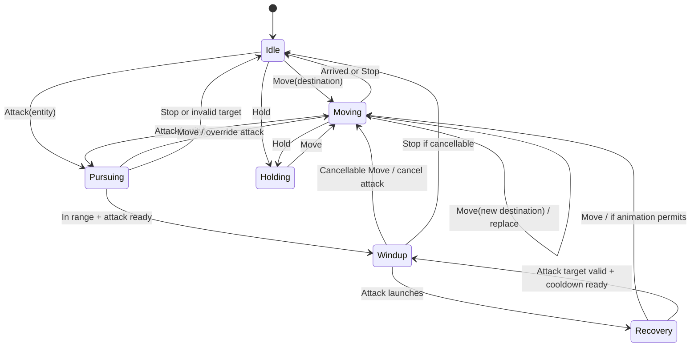

# League of Legends Controls — Elden Ring NPC Mod Specification

**Version:** 0.1 research baseline | **Date:** 2026-10-13  
**Project:** League-style mouse movement and combat using an Elden Ring NPC, initially `c4311` with battle AI `431030`.  
**Scope:** Classic point-and-click League controls; WASD is explicitly out of scope. Camera projection, UI polish, champion progression and networking are secondary.

## 1. Evidence and confidence convention

- **[R] Referenced:** supported by Riot documentation or community-maintained League technical documentation linked in §12. Game values may change by patch or champion.
- **[O] Observed in extracted Elden Ring AI:** supported by the decompiled `431030_battle.lua` supplied for this project.
- **[D] Design target:** our own quantitative engineering goal, **not** a measured League engine value.
- **[H] Hypothesis:** possible Elden Ring mod technique, not yet proven in game.
- **[?] Unknown:** requires code inspection or experiment.

**Important:** Do not treat target latency, tolerances, path recalculation intervals, or feasibility ratings as League measurements. League's internal click processing, path update frequency, and network latency guarantees are not established by these sources.

## 2. Project architecture and scope

We are **not** steering Elden Ring's player character. The proposed controlled avatar is an NPC whose existing navigation and attack animation capabilities will execute higher-level commands. The player character may be hidden, parked, or otherwise handled in a later phase; no solution has been verified.

Proposed flow:

```text
Mouse/keyboard event
  -> cursor-to-world selection (ground or entity)
  -> command resolver (Move / Attack / AttackMove / Stop / Hold / Cast)
  -> command authority and cancellation policy
  -> NPC goal adapter (Lua goal, event target, or other verified hook)
  -> Elden Ring navigation, locomotion, combat animations
  -> observed position / attack events / feedback
```

**Dependency warning:** Lua battle AI decompilation alone does not prove access to Windows input, camera raycasting, world coordinates, or live NPC goal replacement. These are independent integration problems.

### Existing evidence [O]

The decompiled `431030_battle.lua` registers `RoamArmySpearmen431030_Battle`, weights actions in `Goal.Activate`, dispatches via `Common_Battle_Activate`, and contains `AddSubGoal` calls for `GOAL_COMMON_ApproachTarget`, `GOAL_COMMON_SidewayMove`, `GOAL_COMMON_LeaveTarget`, `GOAL_COMMON_Turn`, and combo attacks. `Act13` approaches `TARGET_ENE_0` to a nominal distance argument of `3`; this is **target-relative**, not proof of arbitrary coordinate navigation. The NPC instance-to-battle-goal association comes from the user's Smithbox inspection and remains subject to an in-game identity check.

## 3. Stage definitions and gates

| Stage | Deliverable | Exit criterion | Dependency |
|---|---|---|---|
| S0 — AI research | Verified movement/attack entry points and safe mod loading | Lua goal calls documented, repack/launch path tested offline | Extracted scripts and ModEngine 2 |
| S1 — Fixed movement | NPC walks to a predetermined world destination | 5/5 flat-ground trials arrive without player movement control | S0; point/region goal works |
| S2 — Dynamic movement | New destination replaces current one | 20 successive destination changes without stale-order resumption | S1; writable runtime destination |
| S3 — Mouse-to-world | Ground right-click drives S2 | 20 clicks on navigable ground resolve to correct destinations | S2; input + raycast hook |
| S4 — Combat commands | Enemy click causes pursuit, range stop and attack | 10/10 target acquisitions and correct enemy selection in simple scene | S3; entity picking, team rules |
| S5 — Responsive combat | Stop, hold, attack-move, attack timing and cancellation | Reproducible command precedence and attack-cycle tests | S4; interrupt/cancel control |
| S6 — Abilities and polish | QWER, targeting indicators, advanced navigation and UI | Per-ability acceptance tests; regression suite passes | S5; animation/behavior hooks |

**No stage has been completed in game as of this document.** The code extraction/decompilation milestone is complete, not S0's runtime validation.

## 4. Feature matrix — input, behavior, implementation, feasibility

**Feasibility legend:** H = likely with verified prerequisites; M = technically plausible but substantial integration; L = highly uncertain/engine-limited. Ratings are provisional for this closed-source Elden Ring mod, not general game development.

| Feature | League reference behavior | Quantifiable reference or proposed test | Earliest stage | Feasibility | Principal blocker |
|---|---|---|---|---|---|
| Ground right-click | Issue move order to cursor ground location | [D] 20/20 correct point selections; arrival radius ≤0.75 Elden Ring units (tune) | S3 | M | Raycast and input capture |
| Fixed destination | Navigate to predefined point | [D] 5/5 unobstructed arrivals; record time and path | S1 | M | Position-addressable NPC goal unverified |
| Repeated move clicks | Latest order supersedes prior move order | [D] 20 rapid replacements; no old destination resumes | S2 | M | Dynamic goal cancellation/replanning |
| Obstacle avoidance | Plan around walls/terrain rather than straight-line run [R] | [D] 10/10 reachable obstacle routes; no >2 s stall | S2–S3 | M | Navigation mesh and target goal semantics |
| Unreachable click | Safely stop or select valid reachable endpoint | [D] timeout ≤3 s; no infinite retry | S3 | M | Navigation failure reporting |
| Enemy right-click | Select enemy, approach into range, auto-attack | [D] 10/10 correct targets; ≤1 extra unwanted attack | S4 | M | Entity selection and override of battle AI |
| Attack range | Stop at effective attack distance | [R] Ranges vary by champion; e.g. Hwei 550, Zoe 550 League units; not transferable to Elden Ring units | S4 | M | Hitbox/animation range calibration |
| Auto-attack cadence | Attack at attack-speed-governed intervals [R] | [R] period = 1 / attacks per second; at 0.625 AS = 1.6 s; at 1.0 AS = 1.0 s | S4–S5 | M | Animation lock and NPC attack timers |
| Windup / launch | Attack starts, windup completes, then hit or projectile launches [R] | [R] often ~15–30% of attack cycle; champion-specific | S5 | L–M | Reliable launch event and cancellation window |
| Orbwalking | Move after attack launches while attack timer continues [R] | [D] 10 consecutive attack→move→attack cycles without duplicate hit or stuck animation | S5 | L | Elden Ring attack recovery / animation locks |
| Cancel before launch | Move command during cancellable windup prevents hit [R] | [D] 10/10 early cancels, 10/10 post-launch moves preserve hit | S5 | L | Engine-level animation cancellation |
| A + click attack-move | Move toward location and acquire eligible target according to targeting rules/settings | [D] 10 scenarios, including enemy in path and at destination | S5 | M | Acquisition rules and search query |
| Attack-move-click binding | Single bound input issues attack-move-click without A+click sequence | [D] remappable binding, no duplicate commands | S5 | H once input exists | Input binding |
| S stop | Stop current action/movement (subject to noncancelable states) | [D] stationary within 250 ms in interruptible movement state | S5 | M | Goal clearing and animation state |
| H hold position | Do not pursue distant targets; permit appropriate in-range attacks | [D] no travel >0.5 ER units during 10 s hold | S5 | M | NPC autonomous targeting suppression |
| Target prioritization | Attack-move target selection depends on settings/context | [D] deterministic priority documented; 20/20 expected picks | S5 | M | Target query and filtering |
| Q/W/E/R | Cast mapped ability; targeting varies by skill | [D] four abilities, each with separate targeting/cooldown contract | S6 | M–L | Animation/FX and spell action availability |
| Quick cast | Press key to cast at cursor/target without second click | [D] 20/20 successful aim and dispatch | S6 | M | Raycast and action interface |
| Normal cast | Press key to preview, click to confirm; Esc/right-click cancel as configured | [D] 10 successful confirms and 10 cancellations | S6 | M | UI preview and command state |
| Self cast | Modifier + ability uses self as target where supported | [D] 10/10 self-target dispatches | S6 | H–M | Spell API and modifiers |
| Ground-target abilities | Cast toward coordinate, obey max range | [D] error ≤1 ER unit; clamp or reject consistently | S6 | M–L | Spatial query and engine effect placement |
| Targeted abilities | Cast on eligible entity, follow range/LOS rules | [D] 10/10 correct selection; invalid targets rejected | S6 | M | Entity target binding |
| Movement during casts | Cast-specific locks, channels, and interruptions | [D] explicit state per skill; no unexpected cancel | S6 | L–M | Native animation state control |
| Facing/turning | Orient toward movement/attack target | [D] ≤15° error before attack starts | S2/S4 | H–M | NPC turn rate and facing goal |
| Click feedback | Show move/attack order acknowledgement | [D] visible feedback within 100 ms after local input | S3/S6 | M | Visual effect and input hook |
| Cursor hover and target highlighting | Distinguish ground, enemy, ally, invalid surface | [D] 20/20 classifications in controlled scene | S3–S6 | M | Raycast entity identity |
| Camera-independent commands | Mouse click resolves in world, not character-relative screen movement | [D] same target hit from 3 camera angles | S3 | M | Camera projection/depth selection |
| Key rebinding | Customizable hotkeys and mouse bindings [R] | [D] reloadable keymap with ≥12 actions | S6 | H once input exists | Configuration/input |
| Command queue | Default new movement replaces old movement; specialized actions may queue | [D] one authoritative locomotion command; explicit exceptions only | S2–S6 | M | Scheduler/priority policy |
| Attack while moving | Pursue target, stop and attack only when permitted | [D] no attacks beyond configured range + tolerance | S4 | M | NPC behavior arbitration |
| Minions/other units | Distinguish allies, enemies, neutral units and priorities | [D] 20/20 correct team filtering | S5–S6 | L–M | Engine faction and target enumeration |
| Shift/alt/ctrl modifiers | Modified targeting, leveling, self-cast and binding behavior | [D] no modifier collision across 10 mappings | S6 | H–M | Input hook |
| Ping/minimap/ward/item controls | Auxiliary League interface controls | No quantitative target yet; outside movement/combat MVP | Post-S6 | L–M | UI/map infrastructure |
| WASD | Alternative League control scheme, supported in Ranked in 2026 [R] | Out of scope; not required for project | None | — | Intentional exclusion |

## 5. Quantitative League reference data (do not confuse units)

### 5.1 Attack timer and windup [R]

For an ordinary auto-attack with total attack speed **AS** in attacks per second:

```text
attack_period_seconds = 1 / AS
approx_windup_seconds = attack_period_seconds × windup_fraction
```

This is a simplified benchmark; actual windup modifiers, champion-specific rules, resets and uncancellable attacks can alter it. Windup must finish before the attack launches. A move command during a cancellable windup cancels it; movement after launch does not undo the launched attack. Projectile attacks hit later than launch.

| AS (attacks/s) | Full period | Windup at 20% (illustration) | Post-launch remainder |
|---:|---:|---:|---:|
| 0.625 | 1,600 ms | 320 ms | 1,280 ms |
| 0.75 | 1,333 ms | 267 ms | 1,067 ms |
| 1.0 | 1,000 ms | 200 ms | 800 ms |
| 1.5 | 667 ms | 133 ms | 533 ms |
| 2.0 | 500 ms | 100 ms | 400 ms |

The **20%** column is an illustration, not a universal League setting. Community documentation describes many champion windups as roughly 15–30%. Current general cap documented as **3.003 attacks/s** (≈333 ms/attack) and floor **0.2 attacks/s** (5 s/attack), with exceptions and special modes. Verify current patch before attempting exact emulation.

**Sample champion-specific data:** Hwei's community data lists base movement speed 330 League units, attack range 550 League units and windup ≈18.73%; Zoe lists range 550 and windup ≈16.15%. These are reference examples, not recommended Soldier of Godrick stats. Elden Ring and League units must be calibrated experimentally; **never assume 1 ER unit = 1 League unit**.

### 5.2 Input responsiveness [D]

Riot does not publish a universal, verified “right-click to first locomotion frame” number in the consulted sources. Use the following **mod engineering budgets** instead:

| Metric | Initial acceptance target | Measurement |
|---|---:|---|
| Input received → command state updated | ≤50 ms | Timestamp both events in instrumentation |
| Command updated → NPC starts responding | ≤150 ms median, ≤300 ms p95 | Video/frame logs; exclude intentional attack lock |
| Visual acknowledgement after click | ≤100 ms | Frame-by-frame capture |
| Destination replacement success | ≥95% across 20 tests | Count stale-goal failures |
| Final position tolerance | ≤0.75 ER units on flat ground | Position telemetry/Smithbox measurement |
| Unreachable path recovery | ≤3 s | Timer from issue to fallback state |
| Navigation stall threshold | 2 s without meaningful progress | Position deltas over time |

These numbers are **aspirational and subject to Elden Ring feasibility**. If no reliable instrumentation exists, first record 60 FPS video (≈16.7 ms per frame) and use frame counts as approximate evidence.

### 5.3 Pathfinding and motion [R/D]

Riot explicitly distinguishes classic point-and-click navigation, which plans a route around obstacles in advance, from WASD directional input, which can drive directly into walls. This strongly supports selecting a world-space destination and allowing a navigation system to plan the route rather than steering the NPC directly toward the cursor each frame.

**Unknown:** League's exact navmesh algorithm, path refresh frequency, waypoint spacing, collision resolution and stop tolerance are not established here. Do not invent them. Quantify our own mod with measured route completion, detour ratio (actual path length / unobstructed distance), number of replans, and time stuck.

## 6. Behavioral state machine (design proposal)



**Rule 1:** The latest authoritative move command replaces the prior move command.  
**Rule 2:** Attack command follows a *moving target*, unlike a fixed ground destination.  
**Rule 3:** Ordinary Move suppresses unsolicited NPC enemy pursuit.  
**Rule 4:** Animation locks may defer or reject commands; do not claim instant cancellation until tested.  
**Rule 5:** Attack-move target acquisition must be implemented as an explicit rule, not delegated to random NPC combat weights.  
**Rule 6:** Hold differs from Stop: Hold suppresses pursuit but may permit in-range auto-attacks; Stop halts the current order, subject to animation constraints.

## 7. Input event and command contracts (design proposal)

```text
Move(world_position, sequence_id)
Attack(entity_id, sequence_id)
AttackMove(world_position, priority_policy, sequence_id)
Stop(sequence_id)
Hold(sequence_id)
Cast(slot: Q|W|E|R, target_kind, target_value, cast_mode, sequence_id)
```

Suggested shared command fields: `issued_at`, `sequence_id`, `kind`, `world_destination`, `entity_id`, `is_interruptible`, `source_input`, `resolution_status`. Incrementing `sequence_id` prevents an older asynchronous path/goal result from overwriting a newer click. This is a proposed software architecture, not a known Elden Ring API.

**Ground/entity resolver:** perform raycast; check interactable entity first according to cursor hit policy; otherwise ground; reject UI overlays and invalid hits. The resolver must know the game camera's projection, screen resolution, depth and walkable geometry. The ability to read these from Elden Ring is unverified.

## 8. Feasibility risks and fallback ladder

| Technical dependency | Evidence today | Risk | Fallback if blocked |
|---|---|---|---|
| NPC can move toward another target | [O] `GOAL_COMMON_ApproachTarget` calls | Low for target-relative movement | Use existing enemy/point target |
| NPC can navigate to arbitrary coordinates | [?] not shown in supplied battle AI | High | Region/point goal or movable invisible target |
| Runtime destination can change | [?] | High | Reissue goal or update a tracked target entity |
| Player can issue input to NPC | [?] Lua alone not shown to read raw mouse | High | Separate native hook or scripted test input |
| Mouse click can raycast into world | [?] | High | Debug world-coordinate commands first |
| NPC AI can be overridden persistently | [O] goals/interrupts exist; control override untested | High | Custom goal/param or temporary disable combat selection |
| NPC can attack selected target | [O] enemy-target attacks exist; external selection untested | Medium | Attack predefined target first |
| Attack recovery can be canceled | [?] | Very high | Accept Souls-style recovery; emulate timing at AI level |
| Mod loads safely via ModEngine 2 | [?] not yet runtime-validated | Medium | Minimal noncombat Lua smoke test |

**Stop/go decision:** If fixed coordinate movement fails after the available goal/point approaches are tested, do not start writing a complete input/camera system. Reassess whether movable target entities or another runtime modding route is required.

## 9. Test scenarios and instrumentation

For every test, record game build, mod version, map, NPC entity ID, initial position, target position/entity, issued command, time, observed movement, whether combat AI overrode it, and video or logs.

| Test ID | Scenario | Expected result | Stage |
|---|---|---|---|
| NAV-01 | Fixed point 5 ER units away on flat ground | Reaches tolerance and stops | S1 |
| NAV-02 | Fixed point behind a wall but reachable | Routes around wall | S1–S2 |
| NAV-03 | Point across impassable geometry | Safe failure without endless walking | S2 |
| CMD-01 | A then B destination while moving | B replaces A | S2 |
| CMD-02 | 20 alternating commands | No stale command reactivates | S2 |
| INPUT-01 | Ground clicks from three camera orientations | Same world target selected | S3 |
| INPUT-02 | Click enemy hitbox vs nearby ground | Correctly differentiates Attack vs Move | S3–S4 |
| COMBAT-01 | Attack enemy beyond range | Pursues, stops, attacks | S4 |
| COMBAT-02 | Enemy moves during pursuit | Replans toward moving target | S4 |
| COMBAT-03 | Move while enemy nearby | Does not autonomously attack | S4–S5 |
| COMBAT-04 | Stop during walk | Stops, within animation constraints | S5 |
| COMBAT-05 | Hold while enemy outside range | Does not pursue | S5 |
| COMBAT-06 | Move before attack launch | Cancels if state is cancellable | S5 |
| COMBAT-07 | Move after attack launch | Attack remains valid; movement resumes | S5 |
| COMBAT-08 | A-click past enemy | Acquires eligible target under selected policy | S5 |
| ABILITY-01 | Q ground-target spell | Valid target and range respected | S6 |
| ABILITY-02 | R cast while recovering | Defined queue/reject behavior | S6 |

**Recommended log schema:** `timestamp_ms,sequence_id,command,state_before,state_after,npc_xyz,target_xyz,target_id,goal_name,animation_id,attack_launch_event,arrival_error,reason`. Not all fields are currently available; mark unavailable fields rather than fabricating them.

## 10. Practical implementation order

1. **Codex analysis:** verify relevant Lua goals, parameters, and which file governs nonbattle movement. Confirm `431030` controls the selected instance at runtime.
2. **Safe repack/deployment smoke test:** backup source, repack mod copy, launch through ModEngine 2 with EAC disabled/offline, confirm a harmless change takes effect; preserve saves.
3. **Fixed coordinate navigation:** use the most evidenced position/point/region goal; instrument arrival.
4. **Goal replacement:** update destination while moving, without mouse input.
5. **Mouse hook and world raycast:** ground clicks only; separate from combat.
6. **Target selection and basic attacks:** attack chosen enemy and suppress autonomous decisions during Move.
7. **Stop, Hold and AttackMove:** deterministic precedence.
8. **Attack launch/cancel experiment:** measure actual Elden Ring animation lock behavior before promising League orbwalking.
9. **QWER and UI:** start with one existing NPC attack action per key, then extend targeting and effects.

Do **not** implement all features simultaneously. Each stage should preserve a working baseline and a reproducible rollback.

## 11. Scope boundary and accuracy tradeoffs

- **Gameplay fidelity > visual fidelity:** precise command replacement and target selection matter more than League-like visuals.
- **Navigation fidelity > raw speed:** pathing around geometry matters more than matching champion movement-speed numbers.
- **Combat responsiveness may be engine-limited:** an Elden Ring NPC's native animations may prevent true League attack cancellation. This could require native runtime hooks or accepting a hybrid combat feel.
- **World geometry is different:** rooftops, stairs, cliffs, elevators, interiors and vertical raycasts require extra handling; do not extrapolate flat-ground success.
- **WASD is a real League alternative in 2026**, but is intentionally excluded from this classic point-and-click design.
- **Default controls can be rebound:** labels like A, S, H, QWER are common/default mappings, not immutable universal bindings. Settings and champion-specific input behavior can differ.

## 12. Sources and verification links

1. Riot Games, **/dev: WASD's Ranked Release** (2026-04-14): classic point-and-click path planning versus WASD wall interactions, champion-specific keybinds and input system changes; confirms Ranked rollout. https://www.leagueoflegends.com/en-us/news/dev/dev-wasds-ranked-release/
2. Riot Games, **/dev: WASD Controls Are On the Way** (2025-08-11): confirms classic point-and-click remains available. https://www.leagueoflegends.com/en-gb/news/dev/dev-wasd-controls-are-on-the-way/
3. Riot Games, **Patch 25.24 Notes** (2025): WASD input and camera alternatives; not the target of this spec. https://www.leagueoflegends.com/en-gb/news/game-updates/patch-25-24-notes/
4. League of Legends Wiki (community-maintained), **Attack speed / Attack timer**: attack period, windup/cooldown behavior, cancel semantics, general caps and exceptions. https://wiki.leagueoflegends.com/en-us/Attack_timer
5. League of Legends Wiki (community-maintained), **Hwei data**: example attack range, base movement speed and windup. https://wiki.leagueoflegends.com/en-us/Template%3AData_Hwei
6. League of Legends Wiki (community-maintained), **Zoe data**: example range and windup. https://wiki.leagueoflegends.com/en-us/Template%3AData_Zoe
7. **Project source:** user-provided decompiled `431030_battle.lua`, including `Goal.Activate`, `Act13`, and attack goal calls. Store this in the repository and cite actual file/line references in Codex analysis.

**Research limitation:** This is a feature-complete *planning baseline*, not a frame-perfect reverse-engineering of League's engine. Champion-specific quirks, settings, patches and unexposed engine constants require dedicated testing and are explicitly marked unknown.
