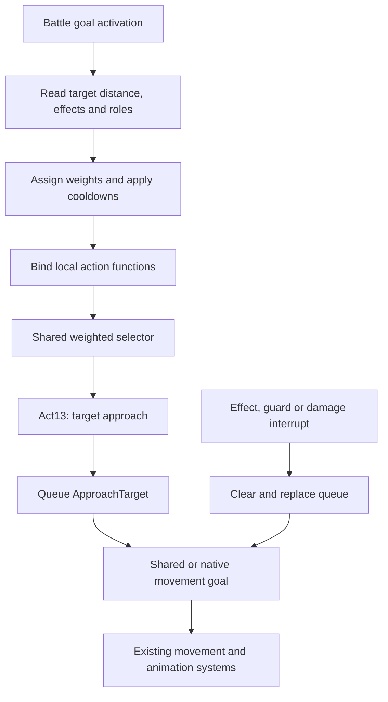

# Godrick Soldier battle AI analysis

Handoff 004 completed 2026-10-13. Research only; no resources modified, compiled, repacked or deployed. Installed build and tutorial-boss identity remain unknown.

## Evidence and architecture

Primary source **B**: `TestingAI/decompiled/431030_battle.lua`, all 1044 lines read. References B:line below are one-based. SHA256: `BB170E62F3D24AEFC5CC1B900BD05EB30B9433C2265C7C0404457EFC34A072A4`.

Binder manifest **M**: `TestingAI/extracted/431030_battle-luabnd-dcx/_witchy-bnd4.xml`: filename at line 3; BND4/DCX_KRAK metadata at 2–6; Lua entry at 19–20 and LUAGNL at 24–25. Its `N:\GR\...` root (line 7) is embedded source metadata, not a directory to access. Binder SHA256: `E17D7A650381DFED962EA102670E3B6C1E44BAE93E953041F75697A4B57028B3`. Decompilation equivalence to original bytecode has not been independently tested.

Handoff004 reports ThinkParam 43114006 selects battleGoalID 431030 and logicId 10000 for c4311_9007/entity 18000257 in m18_00_00_00. **User-confirmed configuration**, not independently parsed param data. B:1 registers the symbolic name `GOAL_RoamArmySpearmen431030_Battle`; its numeric definition is absent here. The “Spearmen” name does not prove equipment or tutorial-boss identity.

Shared logic/common archives exist in `TestingAI/extracted/` but have no readable extracted/decompiled counterparts. They were not unpacked in this session. Public helper examples are evidence about an external implementation, not these supplied archives:

- [ER-oriented common_func_plan.lua](https://github.com/mihai1rus/EldenRingCommonAiFuncs/blob/main/common_func_plan.lua), REGIST_FUNC and Approach_Act_Flex.
- [common_battle_func.lua](https://github.com/mihai1rus/EldenRingCommonAiFuncs/blob/main/common_battle_func.lua), weighted selection. Repository includes refactoring/custom additions.
- [ERAiAPI goal reference](https://eladidu.github.io/readable-ds-lua/dd/dac/_goals_8hpp.html), goal behavior; [API library](../api/INDEX.md) preserves signatures and uncertainty.

| Entry/helper | Observed role and boundary |
|---|---|
| RegisterTableGoal | B:1 associates symbolic goal and name; B:1032 registers a second after-attack goal. Implementation/lookup is shared, absent here. Repeated `Goal` assignments belong to registrations; treating all as one ordinary table overwrite would ignore registration machinery. |
| REGISTER_GOAL_NO_SUB_GOAL | B:2,1033 pass goal constant and true. Exact engine flag meaning not established; it plainly does not mean the script never queues subgoals. |
| Goal.Initialize | B:4–12 enables unfavorable-attack checks with `(4, actionID)` for 3001,3002,3100,3101,3102,3103. Parameter 4's precise meaning not established here. |
| Goal.Activate | B:14–403 initializes pseudo globals, removes three effect observers, computes weights, binds actions, invokes shared selection. |
| Goal.Update | B:907–910 delegates to Update_Default_NoSubGoal; shared continuation/completion semantics need inspection. |
| Goal.Terminate | B:912–914 empty. |
| Goal.Interrupt | B:916–1030 inspects effects/guard/damage, clears and replaces goal queues. |
| Common_Battle_Activate | B:401 passes `(ai, goal, weights, functions, afterCallback, thirdTable)`. Actual six-argument shared implementation absent. Public example has five parameters and cumulative weighted selection; does not establish thirdTable meaning. |
| REGIST_FUNC | B:382–400 wraps selected local functions. Public helper signature `(ai, goal, act, paramTable)` returns a closure invoking act with bound arguments. Installed definition absent. |
| AddSubGoal | Queues movement or attacks; enclosing lifetime precedes the goal-specific parameters. See [existing entry](../api/ai-functions.md#addsubgoal). |

## Action selection and execution flow

B:19–22 creates weights `f2_local0`, registered callable table `f2_local1`, and an unresolved third table `f2_local2`. Weight 50 is a relative selection weight, not automatically 50 percent. Under the public selector, weights are normalized by the total; zero disables selection and registration merely makes a callable available. Actual shared selector/default/debug behavior remains uninspected.

B:26–376 prioritizes mounted-enemy conditions, effect flags, group roles, direction and distance. In the ordinary branch, a rear enemy favors turning (231–238); distance >=4.5 favors approach/circling and effect-enabled attacks (239–283); >=1.7 mixes attacks/circling (284–329); closer favors Act01 and retreat/circling (330–375). These are source branches, not measured NPC behavior. Earlier branches can entirely replace these choices. B:377–381 applies cooldown helpers to actions 1,20,22,23,30; exact cooldown fallback semantics need shared code.

Example trace: ordinary enemy ahead at >=4.5 -> weight[13]=50 at B:243 -> function[13] binds Act13 at B:385 -> Common_Battle_Activate at B:401 -> Act13 at B:543 -> ApproachTarget at B:564. Public helper semantics support the middle dispatch; only an in-game test proves execution.

The diagram's engine execution is documented/inferred, not locally verified pathfinding. No straight-line-versus-route conclusion follows from an approach call alone.

## Complete movement call catalog

Notation: E=TARGET_ENE_0, S=TARGET_SELF, R(a,b)=GetRandam_Int(a,b), G=resultTypeIfGuardSuccess, L=isLifeSuccessGuard. Values below resolve local assignments; every direct goal tuple begins with **lifetime**, then goal-specific arguments. G and L are global references, not known booleans/defaults. APIs are [documented here](../api/ai-goals.md#target-relative-goals-observed-in-431030).

| Caller / call line | Goal and resolved tuple | Apparent operation |
|---|---|---|
| Act02 / 475; Act03 / 525 | LeaveTarget `(R(1,3), E,3.2,E,true,9910,G,L)` | Back away before attacking when initial distance <3.2 |
| Act13 / 564 | ApproachTarget `(10,E,3,S,false,9910)`; walk=true with self effect13282 | Approach current enemy to distance3 |
| Act14 / 584 | SidewayMove `(R(1,3),E,R(0,1),180,true,false,9910)` | Walking target-relative circling |
| Act15 / 607 | ApproachTarget `(R(1,3),E,0,S,true,9920)` then SetTargetRange `(1,6,7)` | Approach; range observer meaning/current ER effect requires care |
| Act16 / 630 | SidewayMove `(R(1,3),E,R(0,1),180,true,false,9920)` then SetTargetRange `(1,6,100)` | Circling with range annotation |
| Act17 / 648 | Turn `(2,E,90,9910,GUARD_GOAL_DESIRE_RET_Continue,true)` | Face target; no destination translation requested |
| Act18 / 667 | LeaveTarget `(1,E,2,E,true,9910,G,L)` | Retreat |
| Act19 / 684 | ApproachTarget `(10,E,10,S,true,9910)` | Walk toward enemy until distance10 |
| Act24 / 807 | ApproachTarget `(4,E,0.1,S,true,9910)` | Close approach after action3026 |
| Act26 / 843 | ApproachTarget `(4,E,0.1,S,true,9910)` if distance>=3 | Close approach |
| Act26 / 862 | SidewayMove `(R(1,2),E,R(0,1),R(30,45),true,true,9910)` otherwise | Short circling branch |
| Interrupt / 1010 | ApproachTarget `(10,E,3,S,false,9910)` when damaged and distance>=4, absent earlier attribute307 branch | Queue replacement with approach |
| Interrupt / 1025 | LeaveTarget `(0.8,E,1,E,true,guard,G,L)`; guard9910 with 30-percent roll, else -1 | Damage-response retreat |

All destinations in this catalog are target-relative; direction selection appears in circling/turning, not explicit coordinates. Goal implementations are shared/native, not defined in B. Assigned variables not passed to a goal are not extra arguments: e.g. Act14's local zero and TARGET_SELF never enter its SidewayMove call.

### Every Approach_Act_Flex call

Tuple after `(ai,goal)` in public helper naming: `(stopDistance,runChanceDistance,forceRunDistance,runChance,guardChance,walkLife,runLife)`. Purpose: choose enemy-relative approach walk/run/guard before attack. This naming is external-source interpretation; the local shared implementation remains missing.

| Caller / line | Resolved arguments | Condition |
|---|---|---|
| Act01 / 423 | `(1.5,0,999,100,100,3,3)` | Always called; effect13282 changes to `(1.5,100,999,0,100,5,0)` |
| Act02 / 461 | `(3.2,0,999,100,100,0,3)` | distance>=3.2; effect13282 -> `(3.2,100,999,0,100,5,0)` |
| Act03 / 511 | Same as Act02 | distance>=3.2; same effect change |
| Act20 / 697; Act21 / 718 | `(3.5,0,999,100,0,3,3)` | Before respective attacks |
| Act22 / 742 | `(5.5,0,999,100,100,3,3)` | distance>=6 |
| Act23 / 774 | `(8.5,0,999,100,0,3,3)` | Before attack |
| Act30 / 889 | `(8.5,0,999,100,0,3,3)` | Only if effect13298; effect13282 -> `(8.5,100,999,0,0,5,0)` |

Public helper uses E and S, picks walk/run lifetime, may add AddDistWalk/AddDistRun to stopping distance, then queues ApproachTarget. Do not infer installed defaults from explicit zeros or transfer public behavior without checking aicommon.

## Attack catalog and movement relationship

All attacks target E. Action IDs are observed numbers; exact animations/equipment effects not identified. Notation T=ComboTunable_SuccessAngle180, C=ComboAttackTunableSpin, R=ComboRepeat, A=AttackTunableSpin, R180=ComboRepeat_SuccessAngle180. Their exact GOAL_COMMON names/signatures are in the [goal reference](../api/ai-goals.md#attack-goals-observed-in-431030).

Tuples below are `(life, actionID, E, successDistance, supplied trailing slots)`; the trailing slots depend on goal family, not one universal schema.

| Caller / call lines | Goal tuples / order |
|---|---|
| Act01 / 436–438 | After helper: T `(5,3102,E,2.5,0,0,0)` -> R `(5,6011,E,1.5,0,0,0)` -> R `(5,3100,E,3,0,0,0)` |
| Act02 / 487; Act03 / 537 | After approach or retreat: T `(5,3100,E,5,0,0,0)` / T `(5,3103,E,5,0,0,0)` |
| Act20 / 705; Act21 / 726 | After helper: C `(5,3008,E,10,0,0,0)` / C `(5,3009,E,10,0,0,0)` |
| Act22 / 751,761 | If close (<=3), C `(5,6001,E,10,0,0,0)`; always queues C `(5,3010,E,10,0,0,0)` afterward |
| Act23 / 782 | After helper: C `(5,3007,E,10,0,0,0)` |
| Act24 / 794 | C `(5,3026,E,10,0,0,0)` before approach |
| Act25 / 821 | C `(5,Rand(3027,3028),E,10,0,0,0)` |
| Act30 / 898 | C `(5,3025,E,10,0,0,0)` after conditional helper |
| Interrupt / 922 | A `(10,3001,E,DIST_None,0,90)` |
| Interrupt / 930,934,943 | R `(5,3103,E,4,0,90)` or R `(10,3002,E,4,0,90)` |
| Interrupt / 957,974,995 | R180 `(5,3011,E,2.5,0,0,0)`, `(5,3009,E,2.5,0,0,0)`, `(0.5,3024,E,10,0,0,0)` |
| Interrupt / 978 | C `(10,3101,E,3,0,0,0,0)` |

Documented successDistance is a goal-end condition, not automatically approach range or weapon reach. Turn-time/facing and vertical slots have family-specific meanings; extra trailing zero in repeat calls is not assigned an invented parameter name. No attack goal implementation is local.

## Interrupts and unresolved source details

B:919–961 handles activated effects when effect5021 is absent: effect13060 at <=6 -> attack3001; activated13067/13068 and guard checks -> queue changes; effect5025 at <=2 -> action3011. B:962–982 handles successful guard with distance/effects/random branches -> 3009 or3101. B:983–1028 handles damage: attribute307 ->3024, else >=4 -> approach, else retreat. Damage branch still returns false at B:1028; special-effect/guard branches return true even if no goal changed. Several independent effect checks can clear goals queued by earlier checks in the same invocation. These are observed facts; callback contract and effect sources remain unresolved.

Other source issues to inspect, not fix in this session:

- Weight[28] assigned at B:278,324,370, but no Act28 binding/definition in B:382–399. Public selector has an error fallback; installed behavior unknown.
- B:400 references `RoamArmySpearmen431030ActAfter_AdjustSpace`; definition B:902 has an underscore before ActAfter. Could be shared alias, source bug or decompiler artifact.
- Act21 is bound B:393 but no explicit weight[21] assignment appears. Act24 weights are explicitly zero where assigned; registered functions are not evidence they are normally selected.
- G/L globals are not defined here; neither are several helper globals. Unused locals/global assignments (e.g. isWalk at509) must not be treated as goal arguments.
- AfterAttackAct Activate is empty B:1035–1037; Update delegates B:1039–1042. It contains no local movement implementation.
- SetTargetRange call sites exist, but [ERAiAPI GoalFunc](https://eladidu.github.io/readable-ds-lua/d4/d58/class_goal_func.html) describes this facility as unused in ER. Presence does not prove it controls stopping.

## Navigation assessment

| Candidate | Local evidence in B | Assessment |
|---|---|---|
| MoveToSomewhere | No occurrence | Externally documented pathing; plausible POINT_EVENT baseline, not tested |
| MoveFollowPathSpecifyPos | No occurrence | Externally documented x/y/z slots; world-space frame, path state and update semantics unknown |
| SetEventMoveTarget / POINT_EVENT | No occurrence | Documented region-to-point assignment; switching among existing region IDs may avoid map reload, but current-goal refresh is unverified |
| SetAIFixedMoveTarget / POINT_AI_FIXED_POS | No occurrence | Documented target-relative endpoint; may set a snapshot without new region/entity. Not an x/y/z setter; snapshot/refresh semantics unverified |
| AiFunc::FollowPath | No occurrence/implementation | External documentation explicitly says pathing. Not proof this battle script computes obstacle routes |
| ApproachTarget | Five action functions plus interrupt | Locally observed target movement calls; fixed-point compatibility requires testing |

**Answer:** no supplied readable code establishes arbitrary world-space navigation or destination replacement without map/entity/reload work. No candidate is proven unsuitable for all navigation; Turn/SidewayMove/LeaveTarget are unsuitable as the sole specified-destination primitive. Missing evidence: readable aicommon and logic10000 implementations/registration, coordinate-goal/native semantics and coordinate frame, target resolution/refresh, navigation prerequisites, and reproducible runtime tests. Changing an action weight changes action selection, not destination data.

## Recommended first experiment — fixed region using the observed approach goal

Comparison:

| Approach | Advantage | Limitation |
|---|---|---|
| Existing Act13 -> stationary enemy | Strongest existing call-site evidence; no region needed | Enemy position is a destination proxy; ordinary pursuit can explain success |
| SetEventMoveTarget -> POINT_EVENT -> ApproachTarget | Uses observed movement goal and externally documented region setup; fixed point separate from enemy | Requires verified reachable region and runtime test of point resolution |
| POINT_EVENT -> MoveToSomewhere | Explicit external pathing semantics | Introduces another goal not present in B; unresolved slots add uncertainty |
| MoveFollowPathSpecifyPos | Potential direct coordinates | Most unresolved behavior; defer |

**Choose region + ApproachTarget** for the first installed-resource test, adapting Act13's known call shape. This refines the earlier MoveToSomewhere recommendation using newly available evidence. It is a proposal, not a change to approved architecture or a navigation claim.

Proposed changes for a later authorized implementation: modify the main `Goal.Activate` (B:14) to take one isolated movement-only branch before normal weighting; set one verified region via SetEventMoveTarget, then queue ApproachTarget using POINT_EVENT, finite lifetime, small explicit tolerance and walking. Adapt the movement portion of Act13 (B:543–564), and return before normal weighted action selection for that test. Do not just weight Act13 to100: existing code would still chase E. Retain registration/update and avoid changing shared logic. Start under conditions without damage/effect interrupts; the current interrupt callback can replace movement, so document interruptions as inconclusive rather than silently suppressing combat reactions. Arrival behavior/repeated activation must be checked before claiming the command is one-shot.

Smithbox: if a suitable point region already exists, record its entity ID/position with no map edit. Otherwise create one in a separate test map override with a verified unused ID; do not invent one here. No ThinkParam edit required if temporarily overriding existing431030; it affects **all users of that battle goal**, not exclusively c4311_9007. Run in a controlled encounter; isolate with a separately registered goal only if later scope/evidence warrants it.

Repack target: copied `431030_battle-luabnd-dcx` corresponding to `script/431030_battle.luabnd.dcx`; preserve manifest Lua ID1000/LUAGNL ID1000000. A compatible Lua5.0 bytecode compilation/repack workflow and unchanged round-trip must be verified first. Merely replacing bytecode with decompiled text and dragging a folder is not a proven deployment method. Do not edit or repack the supplied reference copies.

ModEngine2 proposal: place resulting override at `<enabled mod root>/script/431030_battle.luabnd.dcx`, with optional `map/MapStudio/m18_00_00_00.msb.dcx` if a region was added. Verify the actual configured mod root and launcher, file priority and installed-build compatibility; [official configuration guide](https://github.com/soulsmods/ModEngine2/blob/main/README.md) supports enabled mod directories. Handoff reports configuration, but no local config/launcher was found by the filename search in tools. Use the approved offline/anti-cheat-disabled test setup; no executable patch required by this proposal.

Success: visible locomotion to the recorded region within stated tolerance, enemy/player located elsewhere, repeated same start, no teleportation. This proves fixed-point movement only. Open-ground success does not prove obstacle pathfinding; a later single-obstacle detour would distinguish it from straight-line movement.

Failure interpretation: no change may mean override/activation failure; enemy pursuit may mean wrong target or callback replacement; idle/crash may mean compiler/registration/argument problem; start then stall may mean unreachable point/navigation constraint; timed return to combat may mean lifetime/update/reactivation. Capture footage and exact arguments/build/overrides before drawing conclusions.

Revert: disable/remove only test overrides from the enabled mod root or restore its backed-up previous files; restore optional map override. Original installation and supplied references remain intact. Verify baseline behavior returns. No experiment performed.
